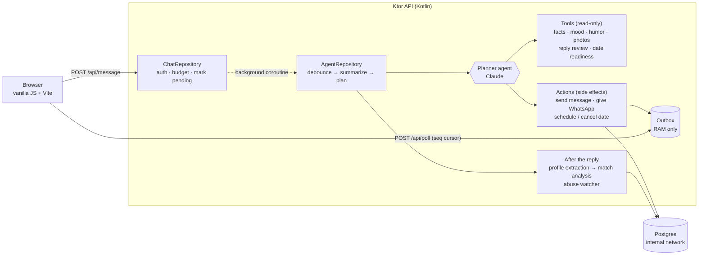

# Date with Roni

**A personal dating site where an AI agent talks to visitors on my behalf.**

Instead of a profile page, visitors chat with *Jimmy-Claude*, my agent. It answers questions about me in my own voice and slang, shows photos when they fit the conversation, and quietly gauges compatibility. When the conversation is going well it hands over my WhatsApp or books a date. When it isn't, it says goodbye.

Live at **[date-with-roni.com](https://date-with-roni.com)** (Hebrew UI).

---

## What makes it interesting

This is a small product. Most of the engineering went into making an LLM agent **safe, cheap and pleasant enough to put in front of strangers**.

| | |
|---|---|
| **A planner, not a pipeline** | Each message goes to one planner agent that picks from ~15 tools and sub-agents (mood reader, humor writer, photo advisor, reply reviewer…). Nothing is hard-wired, so a simple question costs one call and a rich one might take six. |
| **Hard rules live in code, not in prompts** | Read-only *Tools* and side-effecting *Actions* are separate types. Actions enforce their own invariants: a date can't be booked without both *when* and *where*, and WhatsApp hand-off text comes from a closed list I approved. A persuasive model can't talk its way past an `if`. |
| **No state can leak between conversations** | The orchestrator is rebuilt for every message and gets a context scoped to one visitor. There's no field that outlives a request, so one person's conversation has no path into another's. |
| **Privacy by design** | The conversation itself, and the profile the agent builds from it, live **in RAM only**: never in Postgres, never on disk, never in logs. The site says "Roni isn't aware of the conversation", and the architecture is what makes that true. The database holds only outcomes: login identity, token usage, a match score, whether she got my number, and the details of a date she chose to book. |
| **Cost control** | Every conversation has a token budget, metered by a `CountingLlmClient` that wraps *every* LLM call, sub-agents included. Old history is summarized incrementally, because it's re-sent on every agent step and grows with depth. Near the limit, the agent warns the visitor so she can grab the WhatsApp before it goes quiet. |
| **Async chat over plain HTTP** | `POST /message` returns immediately. The agent runs in the background and drops replies into a lock-free outbox. The client polls with a sequence cursor, so a lost poll never loses a message. Rapid-fire messages are debounced into one batch, and a message that arrives mid-thought is passed to the planner as an "interruption" for it to handle. |
| **Defensive layers** | A gibberish filter, an abuse watcher that acts on *patterns* rather than a single sharp message (then sends a farewell and blocks), and a reply reviewer as the last quality gate. If a sub-agent fails, it falls back to a default instead of breaking the conversation. |
| **Honest failure** | If the LLM provider is out of credits or the key is invalid, a server-wide status flips (with `compareAndSet`, so it's logged once) and visitors see it up front instead of an endless "typing…". |

## Architecture



Profile extraction and match scoring run **after** the reply is sent, so they never sit on the visitor's critical path. The "typing…" indicator turns off before they start.

### Infrastructure

```
internet ──► nginx (host) ──► api :8080 (127.0.0.1 only) ──► db :5432 (never public)
             static site
```

- **Postgres is never exposed to the internet.** In the Compose stack it publishes no ports, and its network is `internal: true`, so it has no outbound route either. The API is the only container on both networks.
- **Multi-stage Docker build.** It builds on a JDK 21 image and runs on a JRE image as a non-root user.
- **Google Sign-In.** The server verifies the Google ID token signature itself, then issues its own session token. Only the token's **hash** is stored in the database.
- **Local development** can reach the production DB only through an SSH tunnel to the server's loopback (`dev-tunnel.sh`). There's no public port to connect to.

## Tech stack

| Layer | |
|---|---|
| Backend | Kotlin 2.4, Ktor 3 (Netty), kotlinx.serialization, coroutines |
| AI | Anthropic Claude via the official `anthropic-java` SDK, with two model tiers (fast / smart) |
| Data | PostgreSQL 18, HikariCP |
| Auth | Google Identity Services and server-side ID token verification |
| Frontend | Vanilla JavaScript + Vite, no framework |
| Ops | Docker, Docker Compose, nginx, Portainer |

## Repository layout

```
date-with-roni-server/          Kotlin backend
  src/main/kotlin/com/dateroni/
    orchestrator/               the agent system
      RoniOrchestrator.kt       planner prompt and its arsenal
      agent/                    generic agent loop (tools, actions, depth, timeout)
      subagents/                15 narrow single-purpose agents
      tools/  actions/          read-only capabilities vs. side effects
      llm/                      LLM client abstraction + token counting
    repository/                 orchestration of a chat turn, login, sessions
    state/                      all in-memory state, behind one facade
    servlets/  workers/         HTTP routes → intents → API responses
  migrations/                   SQL schema changes
  docker-compose*.yml           local and production stacks

date-with-roni-website/         frontend
  index.html                    static landing page (readable by crawlers)
  src/main.js                   Google login, chat, polling, photos
  deploy.sh                     build + rsync to the server
```

## Running locally

```bash
# backend: API + Postgres in Docker
cd date-with-roni-server
cp .env.example .env            # fill in the Anthropic key and Google client ID
docker compose up --build
curl http://127.0.0.1:8080/api/health

# frontend
cd ../date-with-roni-website
cp .env.example .env
npm install && npm run web      # http://localhost:5173
```

The persona itself (everything the agent knows about me) lives in `src/main/resources/roni-facts.json`, which is kept out of git. A fresh clone falls back to `roni-facts.example.json` and logs a warning, so the server still runs, just with a sample persona.

The per-project READMEs (in Hebrew) go deeper: the network layout, the Postgres setup, and the Google Cloud configuration.
